# Brandloop reference board (Riso Print direction)

Researched 2026-10-21 with a read-only Playwright browser at 1440x900. Each screenshot is the above-the-fold view
(JPEG, in `refs/`). **We take lessons only: no layout, copy or asset is to be copied.** "Maps to riso" = how the lesson
becomes part of Brandloop's system (paper #F7F6F2, ink #16161D, pink #FF4F9A, blue #2B3FE0, overprint #6B2C9E, grain,
misregistration, hard offset ink shadows, wide display grotesk + Hanken Grotesk).

Capture notes: several sites run an intro or reveal that stays blank in a headless browser until the page receives
mouse movement and scrolling, so the shots were taken after a wake-up scroll. Cookie banners were ignored, never
accepted. A few shots show a banner overlay (Butter, Acquerello, Granola, Attio, Heron).

Legend of tags: `RISO` = print / riso / grain / two-colour flavour, `UI` = in-app product UI, `AIW` = AI writing or
creator tool, `DITHER` = dither / halftone / ASCII treatment, `TYPE` = type-led.

## A. Seed list

| # | Site | Found | Tags | Screenshot |
|---|------|-------|------|------------|
| 1 | [FORMAT by Obys](https://format.obys.agency) | Awwwards SOTD 19 Oct 2026 + Developer Award | TYPE | 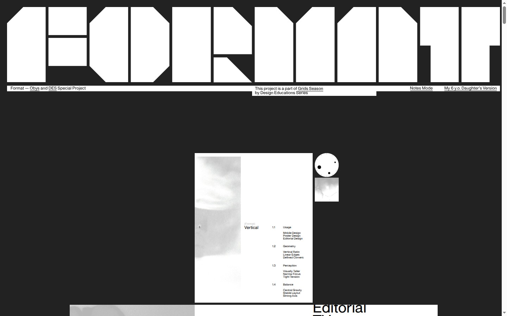 |

**Lesson:** a single gigantic display wordmark spanning the full viewport width, clipped by the grid, then a tiny
mono-sized caption bar with underlined links directly beneath it. The scale jump (about 200px to 11px with nothing in
between) is the whole composition. **Maps to riso:** the Brandloop hero wordmark can run edge to edge in the wide
display grotesk, with the pink and blue plates offset 3px behind it; supporting text stays tiny and ink-only.

| # | Site | Found | Tags | Screenshot |
|---|------|-------|------|------------|
| 2 | [Signal-A Studio](https://signal-a.studio) | Awwwards SOTD 18 Oct 2026 + Developer Award | TYPE | 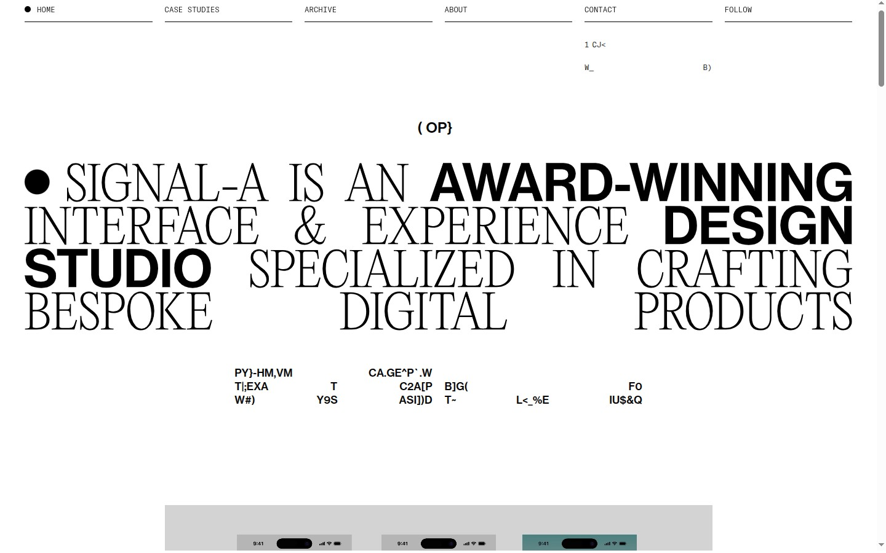 |

**Lesson:** a headline that alternates a light high-contrast serif with a bold grotesk inside one justified block
(AWARD-WINNING, DESIGN, STUDIO in bold). Emphasis comes from font switching, not colour or size. Mono nav links sit on
hairline rules in a 6-column strip. **Maps to riso:** emphasise key words in a headline by swapping weight/width (and
overprinting one word in pink) instead of using gradients or highlights; hairline rules read as print crop rules.

| # | Site | Found | Tags | Screenshot |
|---|------|-------|------|------------|
| 3 | [Heron AI (Bearplus)](https://heronaiapp.com) | Awwwards SOTD 12 Oct 2026 | RISO, DITHER, AIW-adjacent | 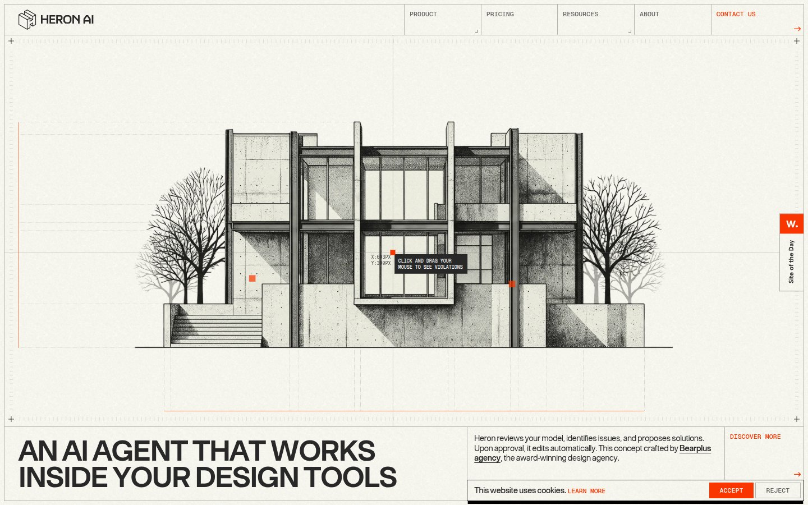 |

**Lesson:** the strongest print reference on the board. Warm paper stock with visible fibre grain, an architectural
drawing rendered in stippled / dithered ink, one hot orange-red spot colour used only for tiny markers, coordinates
and the contact link, and registration-mark crosses in the frame corners. The cursor readout ("X:603px Y:390px")
makes the AI feel like a drafting instrument. **Maps to riso:** use registration crosses and a thin printed frame on
marketing sections, and spot colour at pin-point scale; hero art should be a stippled two-ink drawing, not a gradient
blob.

| # | Site | Found | Tags | Screenshot |
|---|------|-------|------|------------|
| 4 | [Butter by ToyFight](https://butter.video) | Awwwards SOTD 28 Sep 2026 | UI-adjacent | 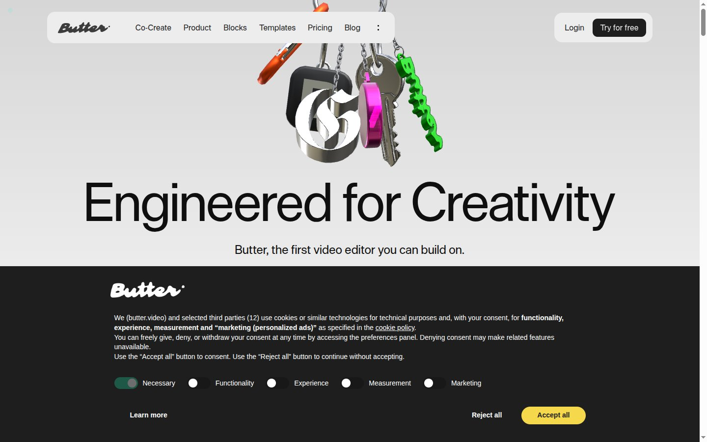 |

**Lesson:** a very plain light-grey field lets one oversized 3D object cluster (the keychain) and a huge tight
headline carry the hero; the nav floats as a rounded pill with blurred backing. Calm background, one hero object.
**Maps to riso:** keep hero backgrounds as flat paper and let a single printed object (halftone sticker or stamp)
carry the energy; avoid a rounded blurred pill nav, use a ruled bar instead.

| # | Site | Found | Tags | Screenshot |
|---|------|-------|------|------------|
| 5 | [Giga](https://giga.ai) | Awwwards, typography category (per plan) | DITHER, TYPE | 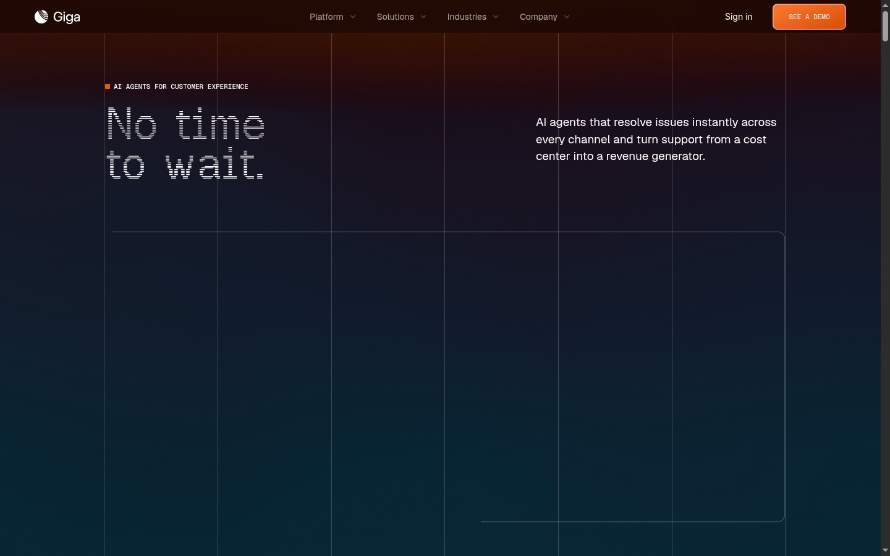 |

**Lesson:** a dot-matrix display face for the hero line ("No time to wait."), vertical column guide lines that are
visible, mono eyebrow with a single square orange bullet, and a rounded frame that is only half drawn. Structure is
made visible as a grid. **Maps to riso:** show the grid as faint print guides in marketing sections; a pixel / dot
display face is a legitimate "halftone type" accent for one headline per page.

| # | Site | Found | Tags | Screenshot |
|---|------|-------|------|------------|
| 6 | [Wafer](https://wafer.ai) | Awwwards, typography category (per plan) | DITHER, TYPE | 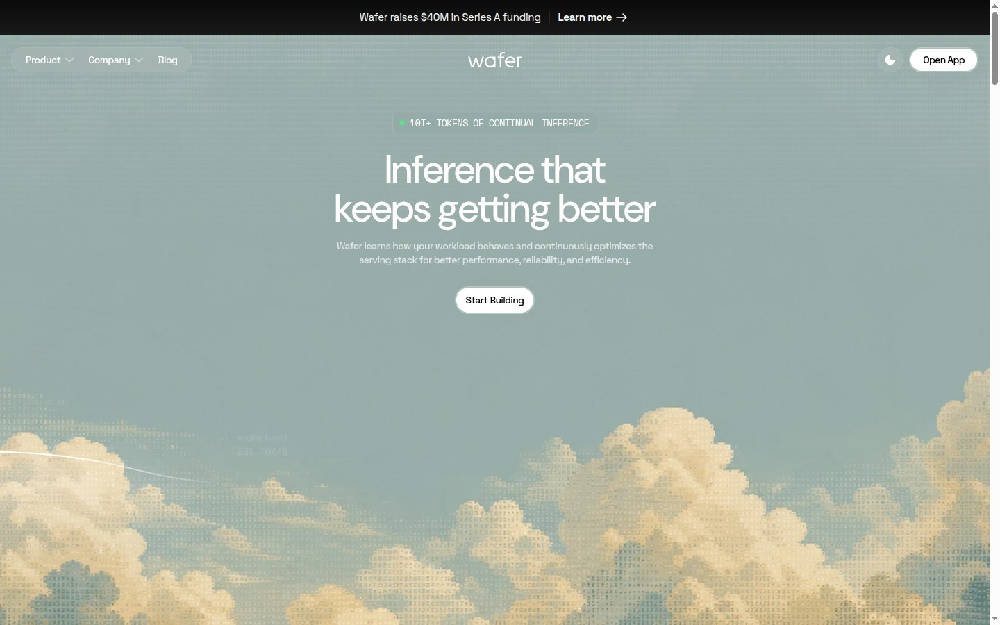 |

**Lesson:** a muted sage sky with clouds rendered as a coarse pixel / ordered-dither raster, overlaid with a light
sans headline and a mono status pill ("10T+ TOKENS..."). The raster gives atmosphere with zero gradients. **Maps to
riso:** the same trick in two inks (pink or blue dither on paper) gives a hero "sky" that is on-brand and cheap
(pre-rendered).

| # | Site | Found | Tags | Screenshot |
|---|------|-------|------|------------|
| 7 | [Ascension by Pegassi](https://ascension.pegassi.be) | Awwwards SOTD 21 Oct 2026 | TYPE | 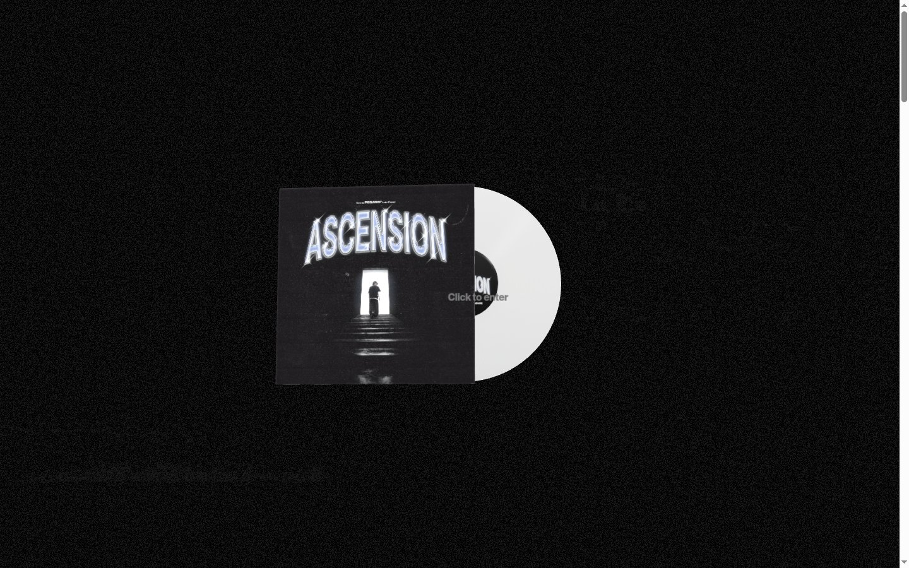 |

**Lesson:** an entry gate. A single object (record sleeve with a white vinyl) in a near-black field with film grain
and an unlabeled "Click to enter" affordance on the object itself, instead of a button. The first interaction is the
object. **Maps to riso:** an onboarding or first-run moment can be a single printed "sleeve" you click to open (the
Home composer), with the grain overlay carrying the mood; the affordance lives on the object.

| # | Site | Found | Tags | Screenshot |
|---|------|-------|------|------------|
| 8 | [Riso Acquerello](https://acquerello.it) | Awwwards (the only "riso"-tagged result) | TYPE | 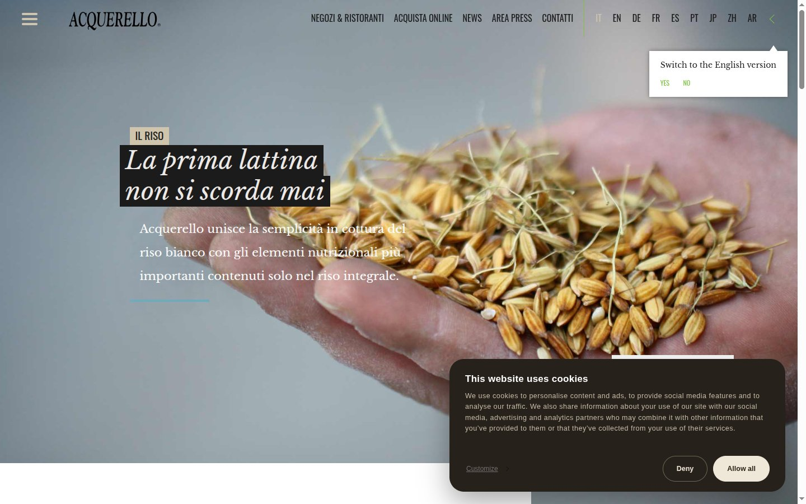 |

**Lesson:** the "riso" here is Italian for rice, not risograph, so it is not a print reference. The usable idea is the
headline set as white italic serif inside solid black text-hugging boxes (one box per line) with a small tan tag above
it. Text plates behind lines ensure legibility over a busy photo. **Maps to riso:** the per-line ink plate is exactly
how a riso overprint label looks; use it for any text that must sit over imagery or dither.

| # | Site | Found | Tags | Screenshot |
|---|------|-------|------|------------|
| 9 | [Linear](https://linear.app) | Seed (product UI) | UI | 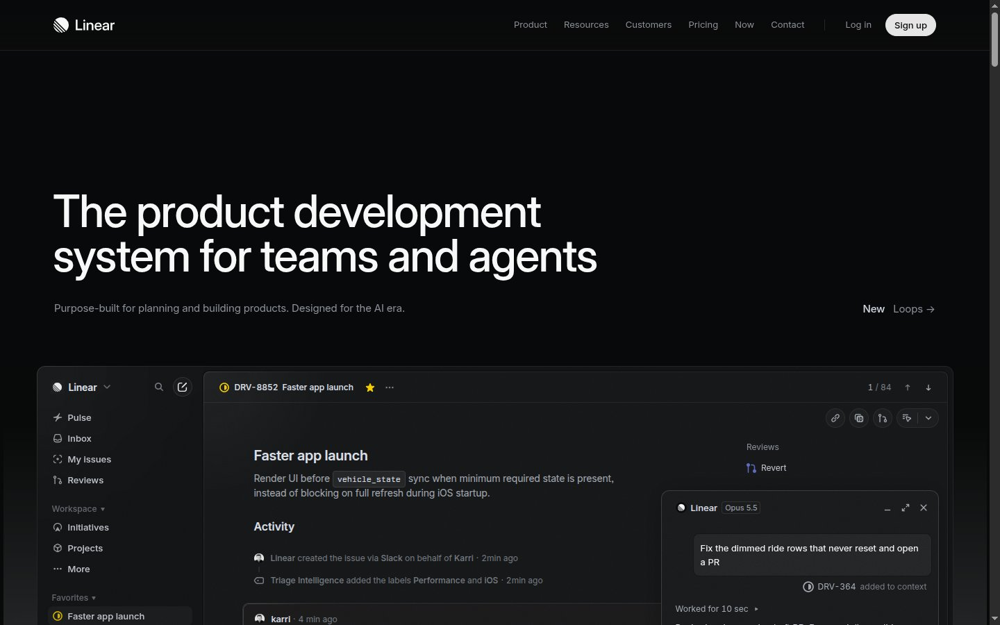 |

**Lesson:** the product screenshot is the hero, cropped at the bottom of the fold so the sidebar, issue title and an
agent panel read as real software. Density is tamed by only two text sizes and almost no colour. The nav is 6 words.
**Maps to riso:** the app shell can be this restrained (sidebar of plain text rows, ink on paper) with colour reserved
for state; the riso layer lives in borders, shadows and empty states, not in every row.

| # | Site | Found | Tags | Screenshot |
|---|------|-------|------|------------|
| 10 | [Attio](https://attio.com) | Seed (product UI) | UI, AIW-adjacent | 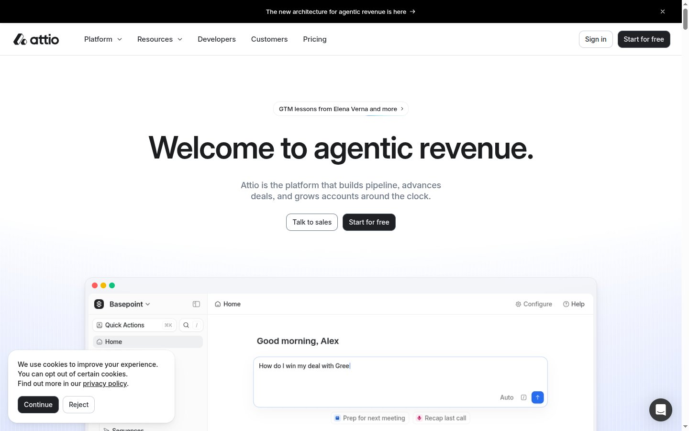 |

**Lesson:** the hero demo is a live product moment: a composer with a typing cursor ("How do I win my deal with Gree|"),
suggestion chips below ("Prep for next meeting", "Recap last call") and a blue send button. The product is shown
mid-task, not static. **Maps to riso:** our hero should type a LinkedIn draft live inside a real composer frame with
chips for "Hook", "Story", "CTA"; the send button is the only blue on the page.

| # | Site | Found | Tags | Screenshot |
|---|------|-------|------|------------|
| 11 | [Stripe](https://stripe.com) (redirects to /in) | Seed (dense data, colour) | TYPE |  |

**Lesson:** a two-tone headline: the first sentence in near-black, the rest in a muted blue-grey, so one paragraph
holds a hierarchy without size changes; a live counter ("Global GDP running on Stripe: 1.735...") adds life with one
number. Content sits inside hairline vertical column rules. **Maps to riso:** use ink vs pink (or ink vs 55% ink)
inside one headline for hierarchy, and one live-ticking number (posts drafted) in the hero.

## B. Own picks

| # | Site | Found | Tags | Screenshot |
|---|------|-------|------|------------|
| 12 | [Sudowrite](https://sudowrite.com) | Own pick (AI writing) | RISO, DITHER, AIW | 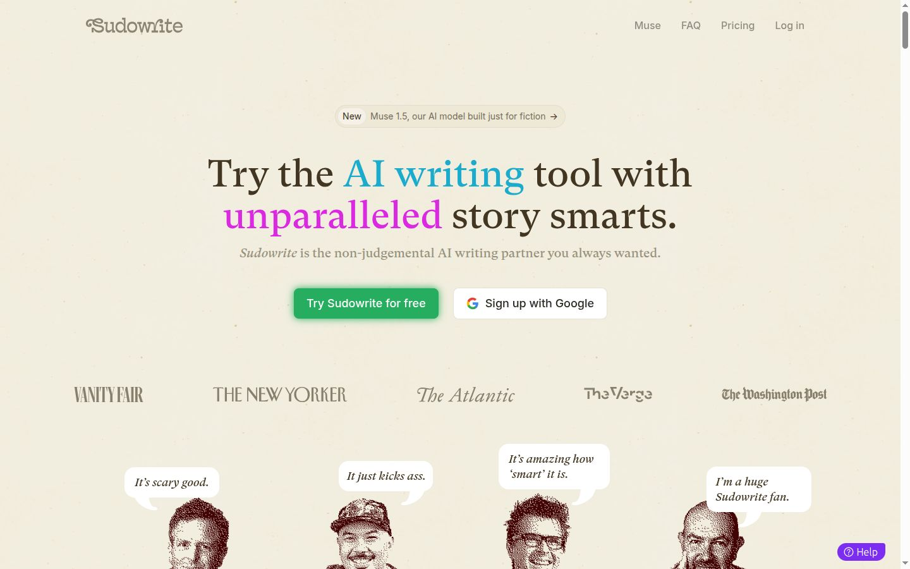 |

**Lesson:** the single best fit for our brief. An AI writing tool on a creamy paper background with speckle, a
serif headline with a few words in spot colours (cyan, magenta), and testimonials as **stipple-dithered portraits**
with speech bubbles. The dithered faces make social proof feel hand-printed. **Maps to riso:** dithered two-ink
avatars for creator-voice cards and testimonials; headline words overprinted in pink / blue.

| # | Site | Found | Tags | Screenshot |
|---|------|-------|------|------------|
| 13 | [Typefully](https://typefully.com) | Own pick (creator tool for X / LinkedIn) | UI, AIW |  |

**Lesson:** the product's own writing app sits dimmed behind a modal-like hero card, so the visitor sees the
real drafts list ("Drafts / Queue 8"), platform tags (X, LinkedIn) and a Schedule/Publish split button before any
marketing copy. Tag chips use mono type ("milestone", "content", "in review"). **Maps to riso:** the draft list with
mono status chips is the right density for Brandloop's content library; our version uses plate-swap chips.

| # | Site | Found | Tags | Screenshot |
|---|------|-------|------|------------|
| 14 | [Granola](https://www.granola.ai) | Own pick (AI notes) | UI, AIW, DITHER | 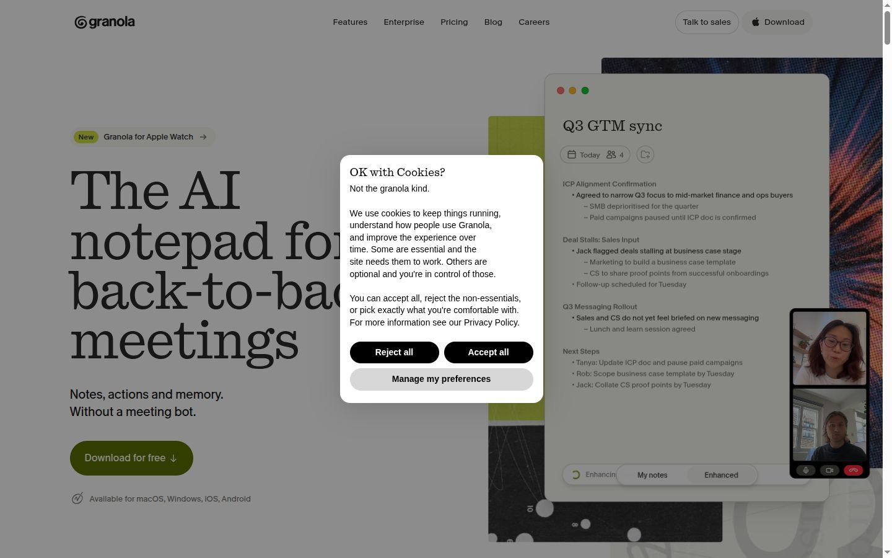 |

**Lesson:** a big warm serif headline against a window frame whose notes are plain text with an "Enhanced / My notes"
toggle, and the backdrop is a halftone-grained photo collage. The AI output is shown as ordinary typed notes, no
sparkle icons. A mode toggle ("My notes" vs "Enhanced") shows the AI's contribution. **Maps to riso:** show AI edits as
a two-ink diff (ink = yours, pink = AI) with a toggle; halftone-grained image plates behind app windows.

| # | Site | Found | Tags | Screenshot |
|---|------|-------|------|------------|
| 15 | [Paper](https://paper.design) | Own pick (design editor UI) | UI, RISO | 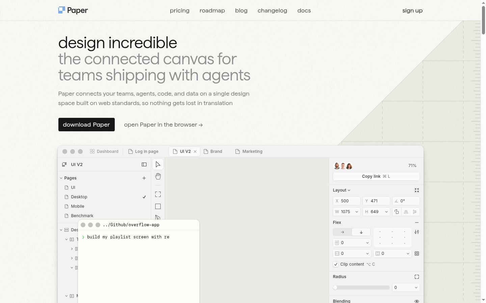 |

**Lesson:** paper-fibre texture and a folded-corner diagonal with ruler ticks wrap a real editor frame (tabs, layers,
property panel with X/Y/W/H grid). The editor is dense but the surrounding stock is quiet. **Maps to riso:** the
property-panel density (small inputs on a strict grid) is the model for our composer's settings side panel; the
folded-corner and ruler ticks are a print-metaphor decoration to borrow for the marketing frame.

| # | Site | Found | Tags | Screenshot |
|---|------|-------|------|------------|
| 16 | [Gumroad](https://gumroad.com) | Own pick (creator platform) | RISO | 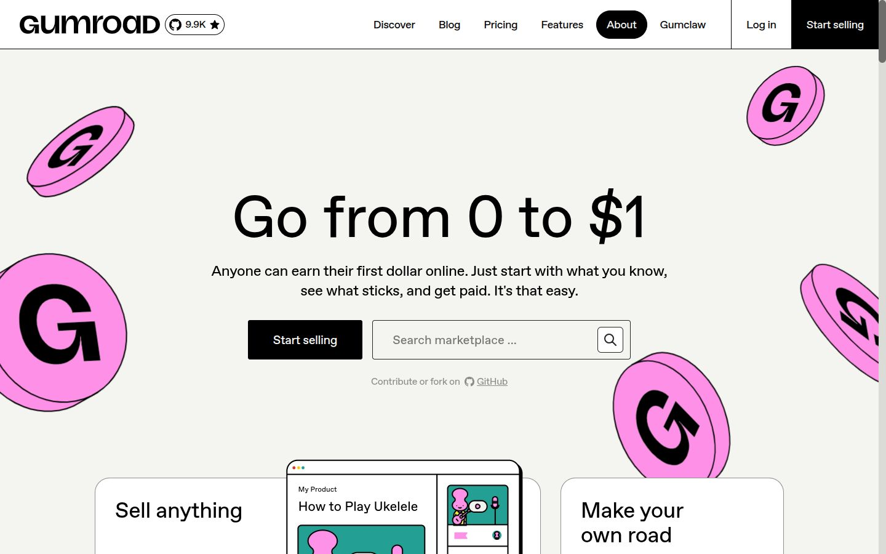 |

**Lesson:** off-white paper (#F4F4F0-like), flat bubblegum pink coins with a heavy black outline and a black offset
"sticker" shadow, black-fill buttons with a 1px frame. Pink + ink + paper, no gradients, a hard look. The nav
highlights the active item as a black pill. **Maps to riso:** confirms pink + ink + paper works commercially; our
difference is the second spot ink (blue) and overprint, plus grain; avoid copying the coin motif.

| # | Site | Found | Tags | Screenshot |
|---|------|-------|------|------------|
| 17 | [Neutomni](https://neutomni.com) | Awwwards SOTD 13 Oct 2026 | RISO, TYPE | 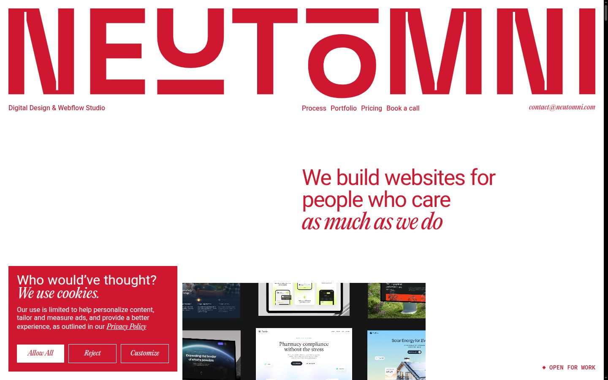 |

**Lesson:** one-ink design. Everything (wordmark, nav, headline, cookie card) is a single red on white, with a
roman/italic serif mix for the emphasis line ("as much as we do" in italic). The constraint makes it feel printed.
**Maps to riso:** a marketing section or an email can run in a single ink for impact, with the second ink held back
for one moment (overprint reveal).

| # | Site | Found | Tags | Screenshot |
|---|------|-------|------|------------|
| 18 | [The Tie-break!](https://thetiebreak.merci-michel.com) | Awwwards SOTD 25 Sep 2026 | RISO | 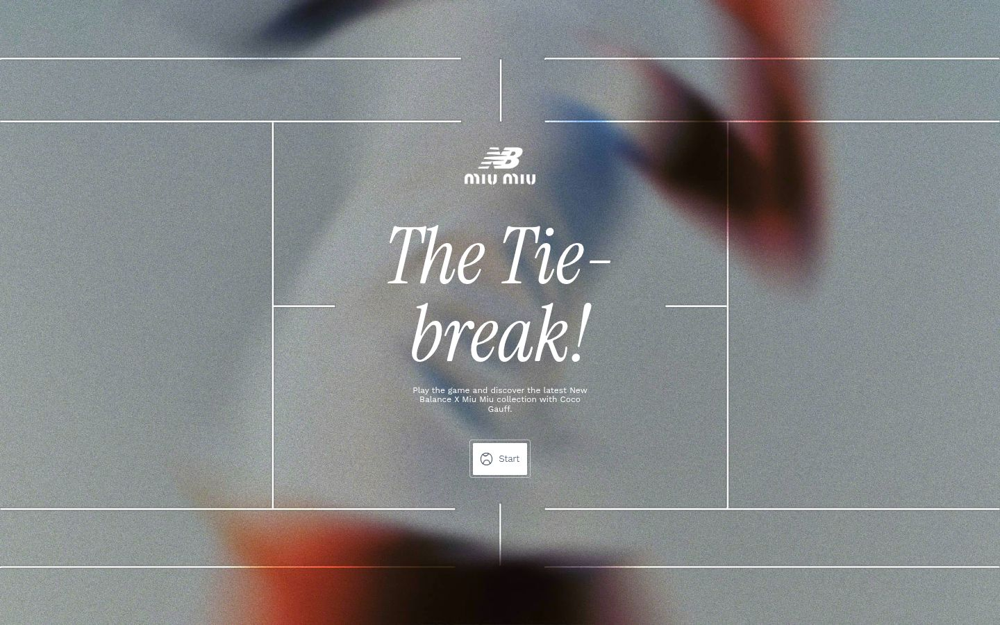 |

**Lesson:** heavy film grain over soft blurred photography with white court-line rules and a centered italic serif
title. Grain is the unifying layer; type is white, thin and calm. A boxed "Start" button with a nested frame. **Maps to
riso:** the grain overlay must be strong enough to be seen at rest, and unify imagery; use blend modes
(multiply on paper, screen on dark) so it also works in night mode.

| # | Site | Found | Tags | Screenshot |
|---|------|-------|------|------------|
| 19 | [Overworld Audio](https://overworldaudio.com) | Awwwards SOTD 15 Oct 2026 | RISO | 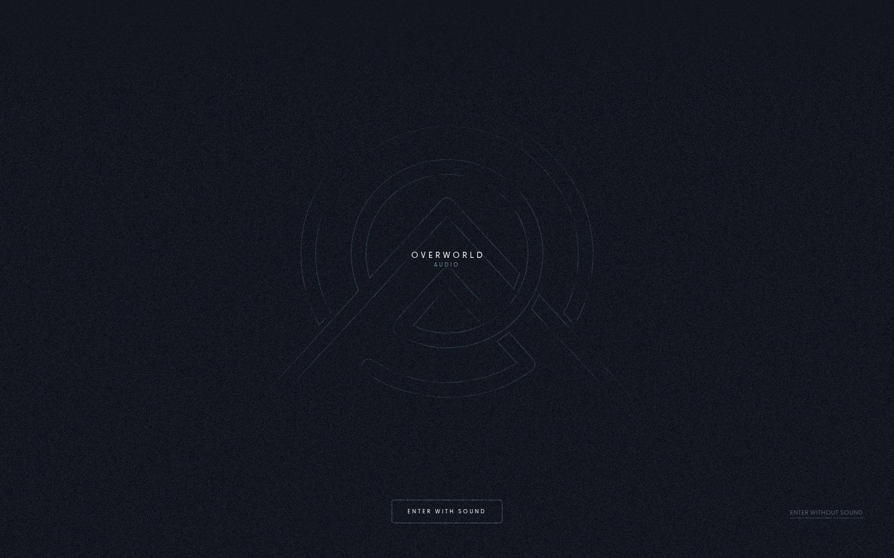 |

**Lesson:** a near-black stage with fine grain and a logo drawn as faint hairline strokes, plus two clear entry
choices ("Enter with sound / Enter without sound"). The logo is an outline that reads as drawn. **Maps to riso:** the
SVG logo mark draws itself on first load with `pathLength`; offer an explicit "reduced motion" style choice in
settings rather than guessing.

| # | Site | Found | Tags | Screenshot |
|---|------|-------|------|------------|
| 20 | [twks](https://twks.ch/en) | Awwwards SOTD 7 Oct 2026 | RISO | 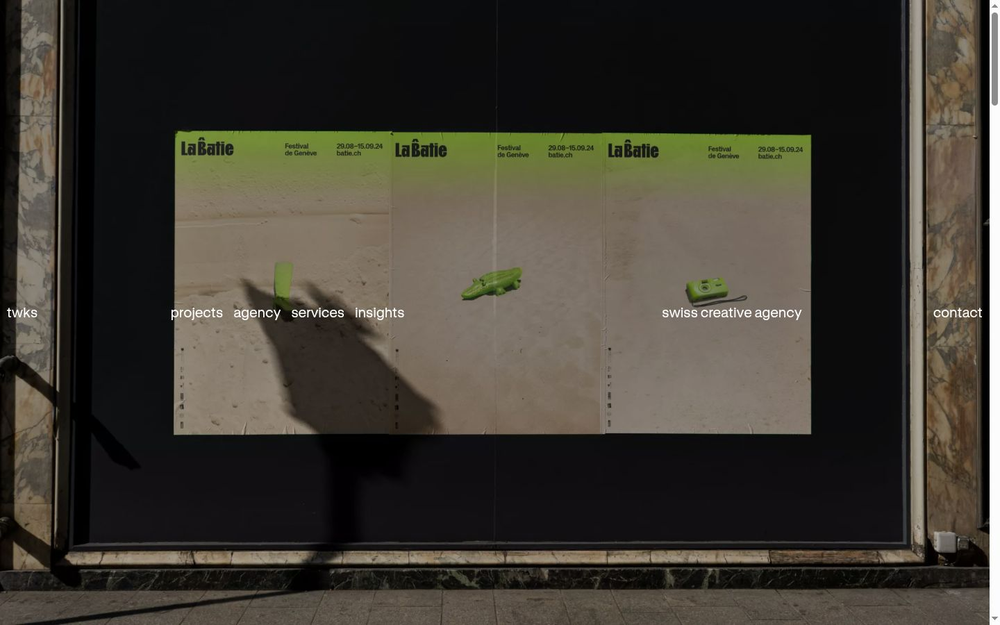 |

**Lesson:** a pasted-poster triptych photographed on a dark hoarding, with the whole nav laid out on a single
horizontal baseline across the viewport in lowercase white. Real print artefacts (posters, paste seams, shadows) are
the hero. **Maps to riso:** use "printed object" photography or mockups (posters, sleeves) for case-study visuals; a
one-line lowercase nav is a clean option for marketing.

| # | Site | Found | Tags | Screenshot |
|---|------|-------|------|------------|
| 21 | [The Surfer's Journal Archives](https://archives.surfersjournal.com) | siteinspire | RISO | 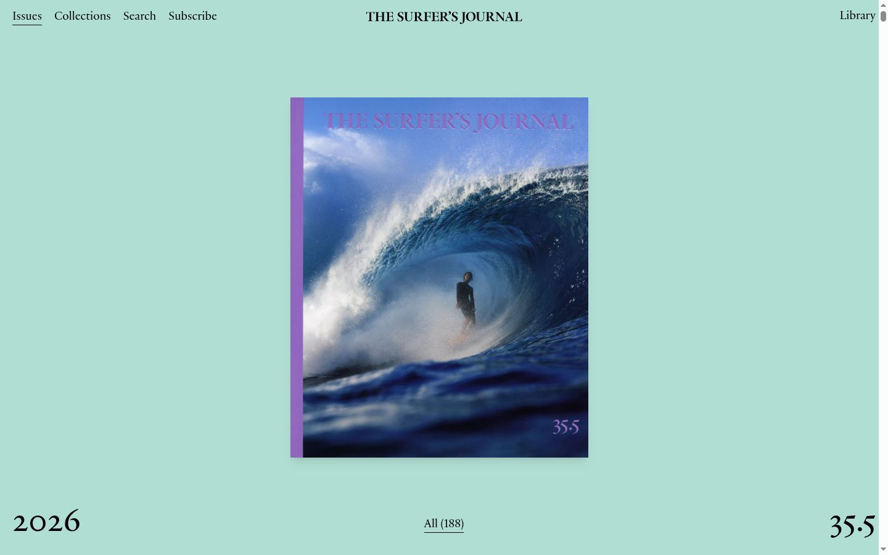 |

**Lesson:** a mint colour field as the whole page, a single magazine cover centred with a soft paper shadow, serif
nav, an old-style numeral year (2026) bottom-left and issue number (35.5) bottom-right. Colour is a stock, not a
gradient. **Maps to riso:** the page background can be a coloured paper stock per section (pink-tint or blue-tint
paper), with numbers set large in the corners as editorial metadata.

| # | Site | Found | Tags | Screenshot |
|---|------|-------|------|------------|
| 22 | [Artemii Lebedev](https://artemiilebedev.com) | siteinspire | UI, DITHER | 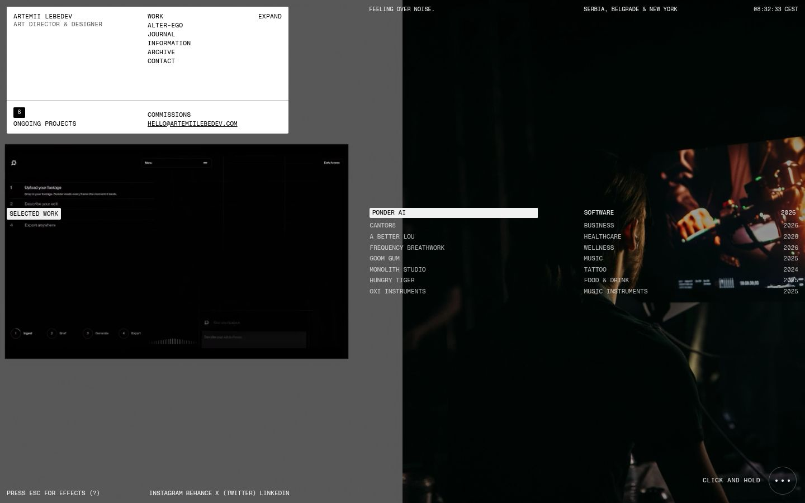 |

**Lesson:** an all-monospace index UI: white info card top-left with a collapsible "EXPAND" control, a project list
where the hovered row inverts to a white bar while a preview thumbnail follows, dates in a right column, and a keyboard
hint ("PRESS ESC FOR EFFECTS"). **Maps to riso:** the invert-bar hover (ink highlighter) for list rows and a visible
keyboard hint line are directly reusable for the command palette and library lists.

| # | Site | Found | Tags | Screenshot |
|---|------|-------|------|------------|
| 23 | [bleibtgleich](https://bleibtgleich.dev) | Awwwards SOTD 22 Sep 2026 | TYPE | 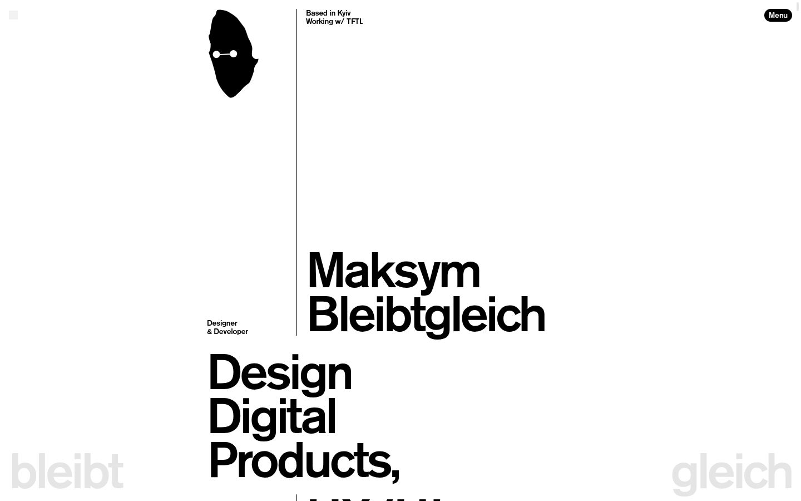 |

**Lesson:** strict black-on-white with a vertical rule that splits a narrow meta column from a large name; ghost
oversized grey type ("bleibt / gleich") pinned to the bottom corners. A silhouette logo with a connected-dot motif.
**Maps to riso:** ghost display type at 8% ink in the page corners gives scale without adding colour; the vertical
rule + meta column is a good page-header pattern for the app.

| # | Site | Found | Tags | Screenshot |
|---|------|-------|------|------------|
| 24 | [Raycast](https://www.raycast.com) | Own pick (product UI marketing) | DITHER | 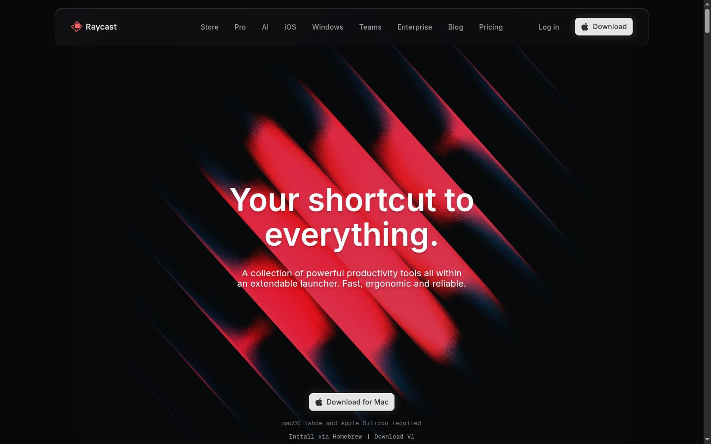 |

**Lesson:** large diagonal red bands whose edges dissolve into grain/noise rather than blur, on near-black. The
"grainy gradient" reads as printed ink falling off. Mono sub-lines for install commands. **Maps to riso:** use a noise
threshold (grain gradient) instead of a smooth blur for any glow or fade; edges of pink plates should speckle out.

| # | Site | Found | Tags | Screenshot |
|---|------|-------|------|------------|
| 25 | [PostHog](https://posthog.com) | Own pick (product UI, personality) | UI | 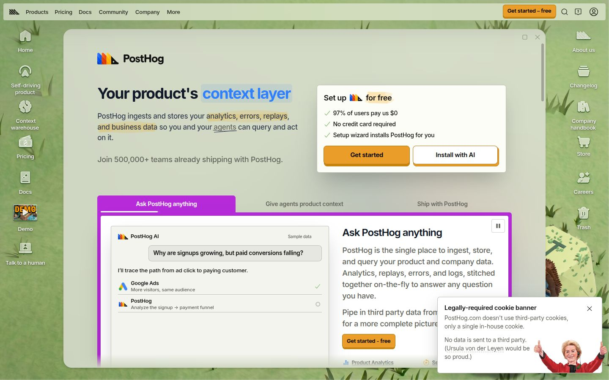 |

**Lesson:** the site is an OS-like desktop with draggable windows, and the product demo is a tabbed panel
("Ask PostHog anything / Give agents product context / Ship with PostHog") with a bold purple frame. Marketing copy
uses a marker-highlight on key words ("context layer", "analytics, errors, replays"). Personality (a jokey cookie
banner) is the brand. **Maps to riso:** hand-marker highlight behind key words in body copy maps to the "highlighter
sweep" micro-interaction; tabbed product demos can use the same plate-swap tabs; keep our humour but not the
cartoon style.

**Count:** 25 references. Riso / print / grain / one-or-two-ink: 9 tagged RISO (Heron, Sudowrite, Paper, Gumroad,
Neutomni, Tie-break, Overworld, twks, Surfer's Journal), plus Raycast and Granola partially. In-app product UI: 7
(Linear, Attio, Typefully, Granola, Paper, Lebedev, PostHog). AI writing / creator tools: 3 (Sudowrite, Typefully,
Granola), with Attio's composer as an adjacent AI input example. Dither / halftone / ASCII flavoured: 7 (Heron,
Sudowrite, Granola, Wafer, Giga, Raycast, Lebedev).

### Dither, halftone and ASCII in the wild

Where the treatment appears on the board and what it is doing (implementation notes are in
`interaction-research.md`, section "Dither, halftone and ASCII").

| Site | Treatment seen | What it does well | Brandloop use it suggests |
|------|----------------|-------------------|---------------------------|
| Sudowrite | stipple / 1-bit dithered portraits in a dark brown ink on cream | humanises social proof without stock photos | two-ink dithered creator avatars |
| Heron AI | stippled architectural drawing on grain paper, orange spot ink | technical, precise, premium | marketing hero art as a two-ink drawing |
| Wafer | coarse pixel / ordered-dither clouds | atmosphere with no gradient | dither "sky" behind hero headline |
| Giga | dot-matrix display type, visible grid | tech-print hybrid for one headline | one halftone-type headline per page |
| Granola | halftone-grained photo plates behind the app window | gives product shots a printed backdrop | image plates behind app screenshots |
| Raycast | grain-dissolved gradient edges (noise threshold) | glow without blur | speckled edge falloff on pink / blue plates |
| Lebedev | all-monospace index, character-cell UI | text-mode precision | ASCII loaders and kbd hints, not body copy |
| Awwwards "Dithered Images" (nahare.xyz) | dithered image element | listed in the Awwwards Inspiration element set; the site itself did not load for us | (reference only) |

### Not captured or not usable

| Site | Reason |
|------|--------|
| nahare.xyz (awwwards "Dithered Images" element) | `ERR_INVALID_AUTH_CREDENTIALS` in the browser; only the awwwards listing page was readable and it has no description. |
| lex.page | Loaded but banner says Lex is no longer accepting new customers; dropped. |
| godly.website | Redirects to recent.design, whose listing returned only post titles; no extra picks taken from it. |
| saasui.design | Page text lists only Notion, Intercom, Linear with no screen details; used for the idea (in-app screens), not as an entry. |
| mobbin.com | Not visited (login wall for most content). |
| Riotters Aevion, Jesper Landberg, Boc.Studio, Resend, Notion, Cursor, Are.na, Print Club London | Captured and reviewed, then dropped for not adding a distinct lesson (kept the board to the strongest 25). |

## Synthesis: design principles for Brandloop

1. **Ink is a system, not a theme.** Everything is one of three inks (ink, pink, blue) plus their overprint (purple)
   on paper; no gradients, no extra greys beyond ink at fixed opacities. Sources: Neutomni (one ink), Gumroad (pink +
   ink on paper), Heron (spot colour at pin-point scale).
2. **Hard edges, hard shadows.** Elevation is an offset solid ink shadow (like a misregistered plate), never a blur.
   The press is the interaction: the shadow collapses as the face moves into it. Source: Gumroad's sticker shadow, the
   offset-button patterns in Part B.
3. **Grain is visible at rest.** Paper fibre plus speckle, strong enough to see, via a blend-mode overlay that works in
   both day and night print. Sources: Heron, Tie-break, Raycast (noise-dissolved edges), Paper.
4. **Scale contrast over decoration.** One huge display line against tiny mono captions; nothing in between. Sources:
   FORMAT, bleibtgleich (ghost type), Signal-A (font switching).
5. **Emphasis by plate, weight or overprint, not by size or glow.** A word can be pinked, overprinted, boxed on an ink
   plate or marker-highlighted. Sources: Signal-A, Acquerello (line plates), PostHog (marker), Stripe (two-tone
   headline).
6. **Show the real product, mid-task.** Hero is a live composer typing a draft with chips, not a mockup of a dashboard
   with floating cards. Sources: Attio, Typefully, Linear, Paper.
7. **AI output looks like writing, not sparkle.** Show AI edits as a two-ink diff with a "mine / enhanced" toggle; no
   sparkle icons, no glowing orbs. Sources: Granola, Sudowrite.
8. **Dither, halftone and ASCII are the image language.** Avatars, hero art and thumbnails are 1-bit or two-ink
   rasters, pre-rendered, so imagery inherits the print look. Sources: Sudowrite portraits, Heron drawing, Wafer sky,
   Giga dot type.
9. **Make the structure visible.** Registration crosses, column guides, rules and corner metadata (year, issue number,
   coordinates) are decoration that doubles as layout. Sources: Heron, Giga, Surfer's Journal, bleibtgleich.
10. **Density belongs to the app, theatre to the marketing site.** The app is Linear-restrained (rows of text, mono
    chips, small inputs on a strict grid); the riso layer lives in borders, shadows, empty states and loaders. Sources:
    Linear, Typefully, Paper, Lebedev.
11. **Hover = inversion or plate shift, never lift.** List rows invert to an ink bar; cards slide a shadow plate; there
    is always a keyboard hint on hover-only affordances. Source: Lebedev.
12. **First interaction is an object, not a button.** Entry moments (composer, onboarding) are a tactile printed object
    that opens, with an explicit motion choice. Sources: Ascension, Overworld.

## Do not (patterns that would read as generic AI-slop)

- Purple-to-blue gradient hero blobs, aurora meshes, glassmorphism cards with blur, glowing neon borders.
- Sparkle / star icons and "AI magic" language for generation; floating orbs; gradient text on "AI".
- Rounded-2xl cards with soft drop shadows and a grey border on every container; pill nav with backdrop blur.
- Three identical feature cards with icon-in-circle, then a logo wall, then a pricing grid in identical rhythm.
- Stock 3D renders (chrome shapes, glass cubes) as hero filler; random bokeh; particle fields with no meaning.
- Dark-mode-by-default with neon accents; mono-everything "terminal" styling applied to a writing product.
- Dashboard hero with fake charts and floating avatar bubbles; fake testimonials with stock faces.
- Animations that float, bounce or pulse endlessly; parallax on everything; scroll-jacking without reduced-motion.
- Copying Kleo's layout or palette, or Gumroad's coin motif; using pink + ink without the second ink and the grain
  (that is just Gumroad).
- Dither, ASCII or grain over body text or dense data: it is for imagery and empty space only.
